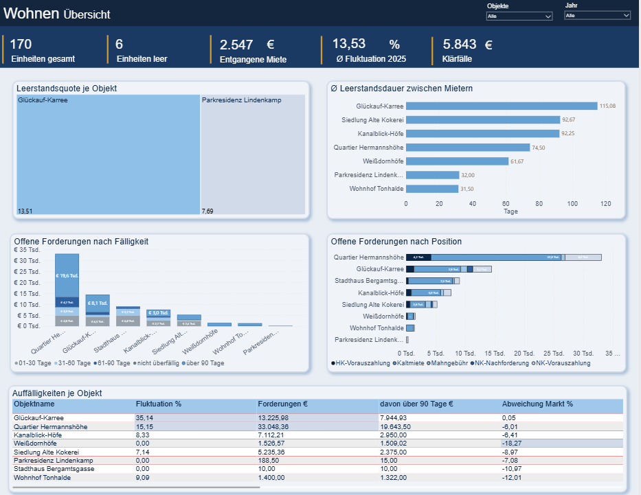
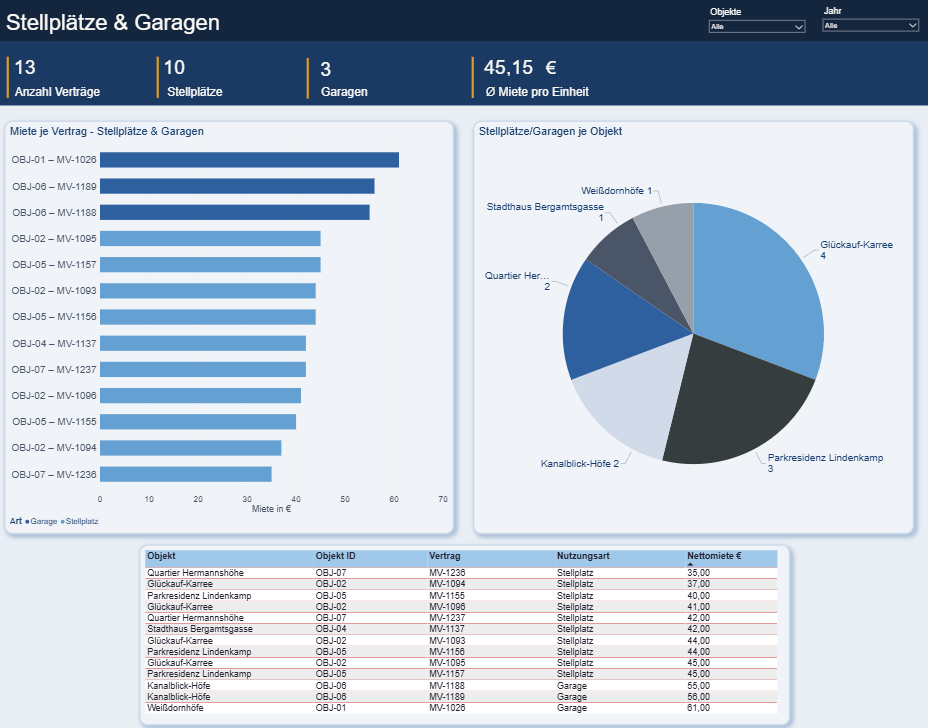
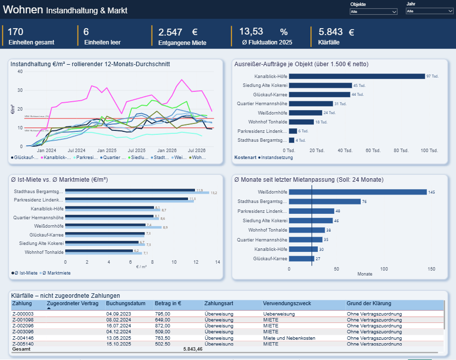
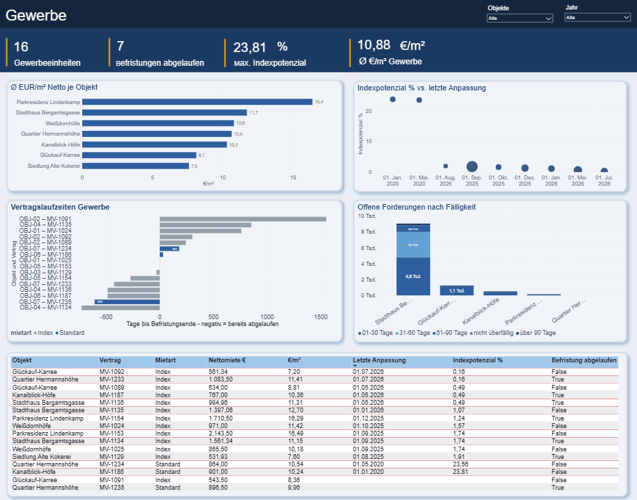

# Kennzahlen-Layer für Hausverwaltungen

Standardisierte Kennzahlen für das Reporting von Hausverwaltungen: 24 SQL-Views auf PostgreSQL (Schema `immo`), dazu ein Ladeskript für CSV-Exporte und ein Power-BI-Dashboard (vom Portfolio bis zur einzelnen Einheit).

**Warum?** Viele Verwaltungen haben weniger Überblick über ihre Daten, als man denkt: offene Forderungen trotz voller Vermietung, Bestände unter Marktmiete, Instandsetzungskosten weit über dem Richtwert. Dieses Projekt macht solche Effekte mit einheitlichen Definitionen sichtbar.

Entstanden in Zusammenarbeit mit Tim Goebel (Goebel & Partner Consulting), der die Verwalterseite und einen synthetischen Testbestand beisteuert (8 Objekte im Ruhrgebiet, 205 Einheiten, 36 Monate, rund 51.000 Datenzeilen).

## Kennzahlen
| Bereich | Views (Auswahl) |
|---|---|
| Leerstand | `v_leerstand`, `v_leerstand_wirtschaftlich`, `v_leerstand_sanierung`, `v_leerstandsdauer` |
| Fluktuation | `v_fluktuation` |
| Forderungen | `v_forderungen_aging`, `v_forderungen_position`, `v_forderungen_gewerbe`, `v_forderungen_saldo`, `v_klaerfaelle` |
| Instandhaltung | `v_instandhaltung`, `v_instandhaltung_benchmark`, `v_instandhaltung_rollierend`, `v_instandhaltung_ausreisser` |
| Mieten und Markt | `v_aktuelle_miete`, `v_marktvergleich`, `v_mietanpassung_aktualitaet`, `v_mietanpassung_intervall`, `v_gewerbe` (Indexpotenzial) |
| Datenqualität | `v_datenkonsistenz`, `v_flaechenabweichung` |
| Gesamtübersicht | `v_auffaelligkeiten` (eine Zeile je Objekt) |

## Dashboard (Power BI)
Das Dashboard liegt auf denselben Views. Hier die vier Seiten mit dem Testbestand:

| | |
|---|---|
|  |  |
|  |  |

Die Power-BI-Datei liegt in `dashboard/Power_BI_Hausverwaltung.pbix` (Testbestand eingebettet, Stand: erste Version). Eine Version mit Parametern für Server, Datenbank und Stichtag, die ohne Anpassung auf eine eigene Datenbank zeigt, folgt.

## Stand und Ausblick
Das Projekt ist nicht fertig. Gerade fertig: das Paket auf frischer Datenbank von null getestet, alle Kontrollwerte stimmen. Als Nächstes testet Tim es an einem echten Bestand (die echten Daten bleiben bei ihm).

Geplant, aus dem Feedback eines Controllers aus der Branche:
- Forderungen: zusätzliche Aging-Klasse „über 1 Jahr“ (Wertberichtigung)
- Indexfristen auch für Wohnungsmietverträge
- Infofelder je Kennzahl im Dashboard
- Fluktuationsschwelle je Region einstellbar
- Wirtschaftlichkeit je Mandat (Aufwand gegen Honorar); offen sind Definition und Datenquelle, da die Stunden aus der Zeiterfassung kommen
- Power-BI-Datei mit Parametern für Server und Datenbank

## Datenschutz
Das Repository enthält außer dem synthetischen Testbestand keine Daten. Power-BI-Dateien werden vor dem Hochladen auf Namen und Verbindungsdaten geprüft. Die Views zeigen Einzelfälle nur mit Vertrags- oder Einheitsnummer, nicht mit Namen.

## Technik
Stand der Kontrollwerte: Testbestand, Stichtag 31.08.2026. Das komplette Paket (Schema, Laden, Views, Kontrollwerte) ist von null auf PostgreSQL 17 (Windows) und PostgreSQL 16 (Linux) mit dem vollständigen Testbestand durchgelaufen; alle Kontrollwerte stimmen. Es sind keine Erweiterungen nötig.

## Inhalt
| Datei / Ordner | Zweck |
|---|---|
| `basis_schema.sql` | Alle 18 Tabellen im Schema `immo` (nur Struktur) |
| `load/` | Ladeskript für die CSV-Dateien (Zwischenschicht `stg`, dann Übernahme nach `immo`) |
| `sql/` | Die Views und die Parameter, eine Datei je View, nummeriert in Laufreihenfolge |
| `install_alle.sql` | Alle Dateien aus `sql/` in einer Datei |
| `kontrollwerte.sql` | Prüfwerte auf dem Testbestand |
| `kontrollwerte_je_objekt.sql` | Soll-Werte je Objekt (nur Testbestand); erwartet: keine Zeile |
| `beispieldaten/` | Der synthetische Testbestand (18 CSV-Dateien, siehe unten) |
| `pflichtfelder.md` | Welche Tabellen und Felder jede Kennzahl braucht |

## Beispieldaten
Im Ordner `beispieldaten/` liegt der synthetische Testbestand von Tim Goebel (8 Objekte im Ruhrgebiet, 205 Einheiten, 36 Monate, rund 51.000 Datenzeilen). Alle Namen, E-Mail-Adressen und Telefonnummern sind erfunden. Der Bestand enthält absichtlich Fehler und Auffälligkeiten, wie sie in der Praxis vorkommen (z. B. fehlende Flächen, Zahlungen ohne Zuordnung, gemischte Zeichenkodierung in einigen Namen).

## Aufsetzen von Null
Voraussetzung: PostgreSQL-Client `psql` und ein Server. Die CSV-Dateien (Semikolon, UTF-8, Dezimalkomma, `ja`/`nein` für Wahrheitswerte, Kopfzeile) liegen im Ordner `daten/` neben `load/`. Zum Ausprobieren mit den Beispieldaten den Ordner `beispieldaten` einmal als `daten` kopieren (PowerShell: `Copy-Item beispieldaten daten -Recurse`, Linux/macOS: `cp -r beispieldaten daten`). Alle Befehle aus dem Paketordner ausführen. Unter Windows (PowerShell) vorher `psql` bekannt machen und die Kodierung setzen, sonst werden Umlaute in den Skripten falsch gelesen:

```
$env:Path += ";C:\Program Files\PostgreSQL\17\bin"
$env:PGCLIENTENCODING = "UTF8"
createdb -h localhost -U postgres hausverwaltung
psql -h localhost -U postgres -d hausverwaltung -f basis_schema.sql
psql -h localhost -U postgres -d hausverwaltung -f load/laden.sql
psql -h localhost -U postgres -d hausverwaltung -f install_alle.sql
psql -h localhost -U postgres -d hausverwaltung -f kontrollwerte.sql
psql -h localhost -U postgres -d hausverwaltung -f kontrollwerte_je_objekt.sql
```

Verbindungsdaten (Server, Port, Benutzer, Datenbank) stehen nur in diesen Befehlen und im Power-BI-Parameter. In den SQL-Dateien stehen keine Verbindungsdaten.

## Einstellungen an einer Stelle
| Einstellung | Tabelle | Standard |
|---|---|---|
| Stichtag | `immo.parameter_stichtag` | 31.08.2026 |
| Karenztage | `immo.parameter_karenz` | 5 Tage, je Objekt überschreibbar |
| Soll-Mietzyklus | `immo.parameter_mietzyklus` | 24 Monate |

Stichtag ändern: `UPDATE immo.parameter_stichtag SET stichtag = DATE '2026-09-30';`
Alle Views lesen ihn über `immo.stichtag()`. Fluktuationsjahre und Vorjahr werden daraus abgeleitet. In den Marktmieten muss es eine Zeile für das Jahr des Stichtags geben.

## Eigene Daten laden
1. `load/01_stg_tabellen.sql` legt für jede Tabelle eine Zwischentabelle in `stg` an (alle Spalten als Text).
2. Eigene Quelldaten werden in diese Tabellen geladen. Die Spaltenzuordnung steht in `pflichtfelder.md`.
3. `load/03_nach_immo.sql` wandelt Dezimalkomma, `ja`/`nein` und leere Felder um und schreibt nach `immo`.

**Achtung:** `load/03_nach_immo.sql` leert zuerst die 18 Tabellen in `immo`. Parameter und Views bleiben unberührt.

## Datenqualitätsprüfungen
- `v_datenkonsistenz`: unvollständige Stornoketten, aktiver Vertrag bei offenem Leerstand, fehlende oder unplausible Fläche, Klärfälle
- `v_flaechenabweichung`: Stammdatenfläche gegen Summe der Einheiten
- `v_klaerfaelle`: Zahlungen ohne Zuordnung

## Definitionen
- Quoten werden als Summe Zähler ÷ Summe Nenner berechnet, nicht als Durchschnitt der Objektquoten.
- Forderungen: Karenztage werden von der Überfälligkeit abgezogen, Stornozeilen sind ausgeschlossen. Aging-Klassen: nicht überfällig, 01-30, 31-60, 61-90, über 90 Tage.
- Leerstand wirtschaftlich: entgangene Sollmiete ÷ theoretische Gesamtmiete, ohne sanierungsbedingten Leerstand (separat in `v_leerstand_sanierung`).
- Instandhaltung €/m²: Instandhaltung + Instandsetzung netto ÷ Stammdatenfläche. Richtwert 15 €/m², Modernisierung separat. Ausreißer: Aufträge über 1.500 € netto.
- NK-Gutschriften werden getrennt ausgewiesen und nicht mit Forderungen verrechnet.
- Die Views zeigen Einzelfälle nur mit Vertrags- oder Einheitsnummer, nicht mit Namen.

## Bekannte Einschränkungen
- Das Jahr 2023 ist in `v_instandhaltung_benchmark` als Rumpfjahr markiert (Datenbeginn).
- Die Spaltennamen `…_2025` in `v_auffaelligkeiten` sind historisch. Inhaltlich ist es das Vorjahr des Stichtags.
- Mietanpassung: gemessener Abstand im Schnitt 3,3 Jahre gegen 1,5 Jahre erwartet, Ursache ungeklärt.
- Keine Mandatsebene: Auswertung nur je Objekt.
